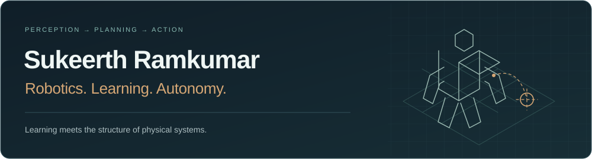
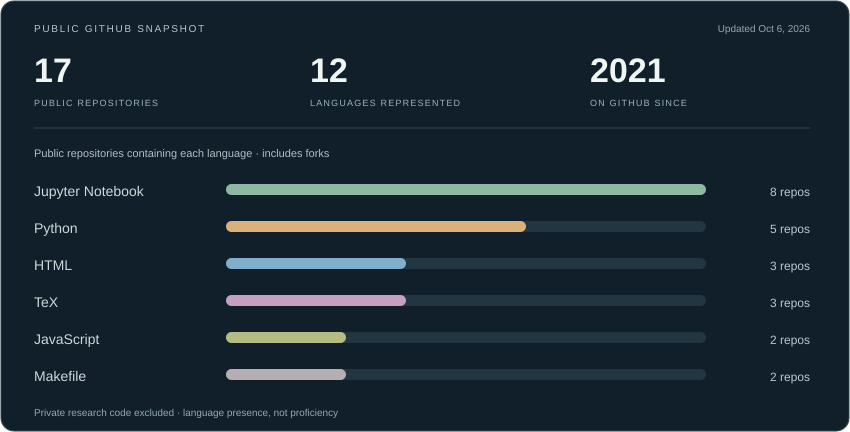

**Stanford MS, Robotics focus · Stanford Robotics Center · San Francisco Bay Area**

I build systems that connect **perception, planning, and action**—from humanoid mobile manipulation to spacecraft rendezvous. My interests span robot learning, computer vision, planning under uncertainty, and guidance and control. Before Stanford, I studied at **IIT Madras** and led the Horizon physics and astronomy club.

[Google Scholar](https://scholar.google.com/citations?user=t6kfYF0AAAAJ&hl=en&authuser=1) · [LinkedIn](https://www.linkedin.com/in/sukeerth-ramkumar/) · [Email](mailto:sukeerth@stanford.edu)

### Selected research

| Work | What I contributed | Explore |
| :--- | :--- | :--- |
| **Humanoid mobile manipulation** | A symbolic world model that preserves object identity through occlusion, grasping, carrying, and reacquisition on Fauna Sprout. | [Stanford Robotics Center feature](https://www.linkedin.com/posts/stanfordrobotics_sukeerth-ramkumar-an-src-summer-intern-activity-7505427375355056129-7zJ2) |
| **TouchWorld · generative 3D & haptics** | Registering generated geometry and conditioning collision meshes for force-feedback interaction. First-author manuscript **submitted to ICRA 2027**. | [Stanford project](https://charm.stanford.edu/ME327/2026-Group8) |
| **Action-conditioned world models** | A self-supervised JEPA model for BEV driving: **88.7% lower 4-second rollout error** versus LeWM on nuScenes in our evaluation. | Research project |
| **Spacecraft trajectory learning** | Multi-objective trajectory data generation and transformer-based imitation learning for safe rendezvous warm-starts. Coauthor of **JGCD** and **AIAA SciTech 2026** papers. | [SAGES project & papers](https://semantic-guidance4space.github.io/) · [Team demo](https://www.youtube.com/watch?v=4SiT27Faw6A) |
| **Learning for multi-agent planning** | Graph neural networks for conflict selection in Conflict-Based Search, trained on optimal MAPF traces and evaluated through feature ablations. | Research project |

Much of my current research code is private. Public project pages and papers are linked above; the repositories below are accessible examples.

### A few things you can explore here

| Repository | At a glance |
| :--- | :--- |
| [**Decision making under uncertainty**](https://github.com/Sukeerth-v9474/CS238) | Stanford CS238 projects and final project. Course repository fork with my implementations. |
| [**Reinforcement learning coursework**](https://github.com/Sukeerth-v9474/CS6700_Jan_May_2024_Team_Pioneers) | Team coursework, including REINFORCE implementations and plotting notebooks. |
| [**Stellar clusters · Horizon**](https://github.com/Sukeerth-v9474/Stellar_Clusters_Horizon) | Theory and simulation references, including the Plummer model. A forked Horizon project repository. |
| [**Langton's Ant**](https://github.com/Sukeerth-v9474/Langton-Ant) | A small p5.js simulation of emergent behavior. |

### Tools I work with

**Python · C/C++ · MATLAB · Julia** 
**ROS2 · PyTorch · OpenCV · MuJoCo · Isaac Lab** 
Robot learning · 3D perception · sensor fusion · motion planning · optimization · feedback control

### GitHub at a glance

The card refreshes automatically from public GitHub data. Language counts show how many public repositories contain each language, including forks; they are not proficiency scores. Private research code and this profile repository are excluded from the language counts.
